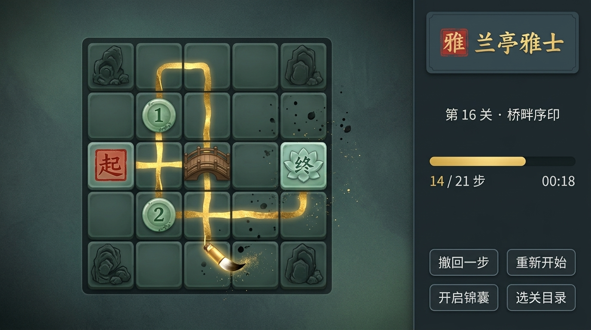
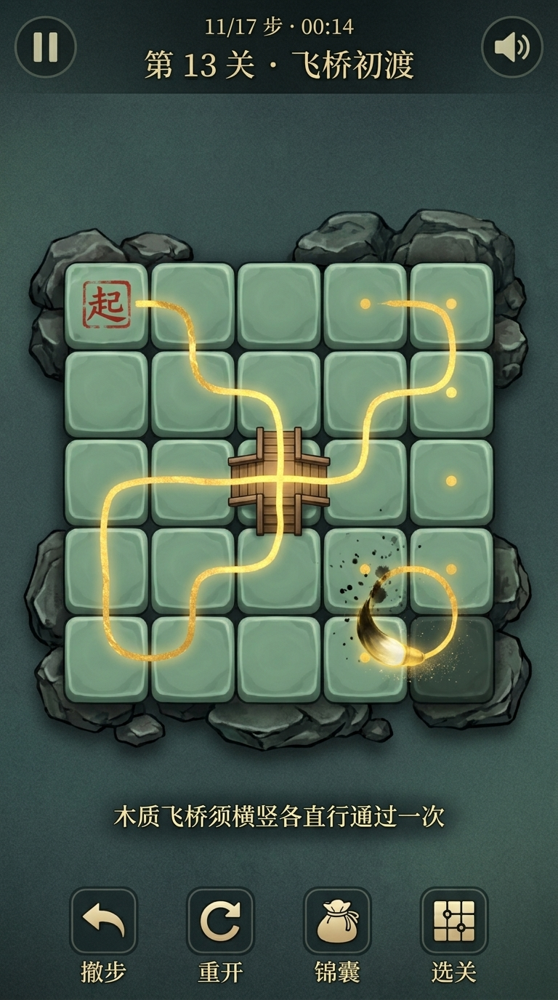

# 墨径 · 一笔通幽

> 宋韵青瓷金缮主题益智一笔画 Web 游戏 — 专为移动端触控与桌面端游赏打造。

## 在线试玩（发布页）

- **在线体验地址**：[https://mojing.ai.studio](https://mojing.ai.studio)

打开链接即可直接在手机浏览器或电脑浏览器中畅玩，无需下载安装，通关进度与雅士称号自动保存至本地。

---

## 游戏截图

### 主界面 · 宋韵青瓷庭院


### 桌面端对局 · 双栏庭院棋盘与雅士看板


### 移动端竖屏 · 单指滑动连线与墨迹喷溅
<p align="center">
  
</p>

---

## 核心玩法与章节

从朱红 **「起」** 印出发，以一笔不断之势连遍庭院内的全部青石板。游戏内置 **四卷共 24 个经路径算法校验的手工关卡**，并附带 **每日雅局** 与 **随机无尽演练**：

| 章节 | 关卡范围 | 核心机制 |
| :--- | :--- | :--- |
| **卷一 · 素石问径** | 第 01 – 06 关 | 基础一笔画寻径、庭院假山障碍、青玉 **「终」** 莲收尾 |
| **卷二 · 序印寻幽** | 第 07 – 12 关 | 数字 **序印（1 → 2 → 3 → 4）**，须按升序依次贯通 |
| **卷三 · 飞桥渡墨** | 第 13 – 18 关 | 木质 **「飞桥」**，须横竖各直行通过一次，桥面不可折转 |
| **卷四 · 月门洞天** | 第 19 – 24 关 | 成对 **「甲 / 乙」月门** 空间穿梭，与飞桥、序印交织的终章大局 |
| **每日雅局 / 随机新局** | 无尽演练 | 每日按日期生成固定种子庭院，另支持随时生成全新随机谜题 |

---

## 特色亮点

- **手写感墨迹粒子特效**：基于独立 60fps Canvas 粒子层，滑动连线时沿行笔方向自然喷溅淡墨微滴、金缮微尘与柔和墨晕；撤步与通关时亦配有轻散墨雾与收笔流光。
- **雅士称号与进度看板（雅士录）**：依据每局通关的**行笔连贯度**、**步数精准度**与**耗时**，实时颁发单局书法墨评（如《行云流水》《一气呵成》《笔走龙蛇》《落墨无悔》），累计晋升「初执墨毫 → 通幽书圣」八阶雅士阶位，并可解锁与自由佩戴 6 枚主题书法印号。
- **三阶智能锦囊**：内置轻量级实时回溯求解器，支持 3 步指引、6 步指引与完整金径展开；当玩家偏离至死胡同时自动标出最佳回退节点。
- **五声音阶古筝合成音效**：纯浏览器 Web Audio API 实时合成宫商角徵羽五声音阶弹拨声、木桥叩击声、月门清音与星印渐升铃音，支持随时静音。
- **通关星级金缮入场动画**：结算界面三颗金印星按序拱形弹出，伴随金缮涟漪光环、细碎金粉飞溅与柔和星芒闪烁，并完整适配 `prefers-reduced-motion` 无障碍设置。

---

## 操作方式

- **手机端 / 触屏**：单指按住连续滑动连线；向后回滑或轻点已走石板即可撤步；底部拇指区一键撤步、重开、开启锦囊或切换关卡。
- **桌面端 / 键盘**：
  - `鼠标拖拽 / 点击`：连线或点击已走石板回退
  - `方向键` / `W A S D`：逐格移动笔锋
  - `Z` / `Backspace`：撤回一步
  - `R`：重新开始本关
  - `H`：逐阶开启锦囊提示
  - `M`：切换音效开关
  - `Esc`：暂停 / 关闭弹窗
  - `Enter` / `Space`：开始解谜或进入下一关

---

## 本地运行与构建

### 环境要求
- Node.js 18+

### 启动开发服务器
```bash
npm install
npm run dev
```
启动后访问 `http://localhost:3000`。

### 构建生产版本
```bash
npm run build
```

---

## 技术栈

- **前端框架**：React 19 + TypeScript + Vite
- **样式系统**：Tailwind CSS v4
- **图形与动画**：SVG 金缮路径渲染 + 60fps HTML5 Canvas 墨迹粒子引擎 + CSS Compositor 动效
- **音频引擎**：原生 Web Audio API 五声音阶程序化合成器
- **数据存储**：`localStorage` 本地进度、每日挑战与雅士称号存档
